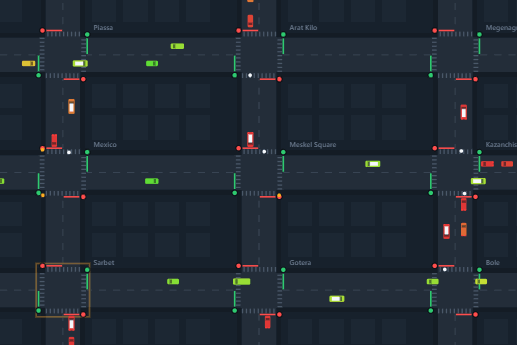
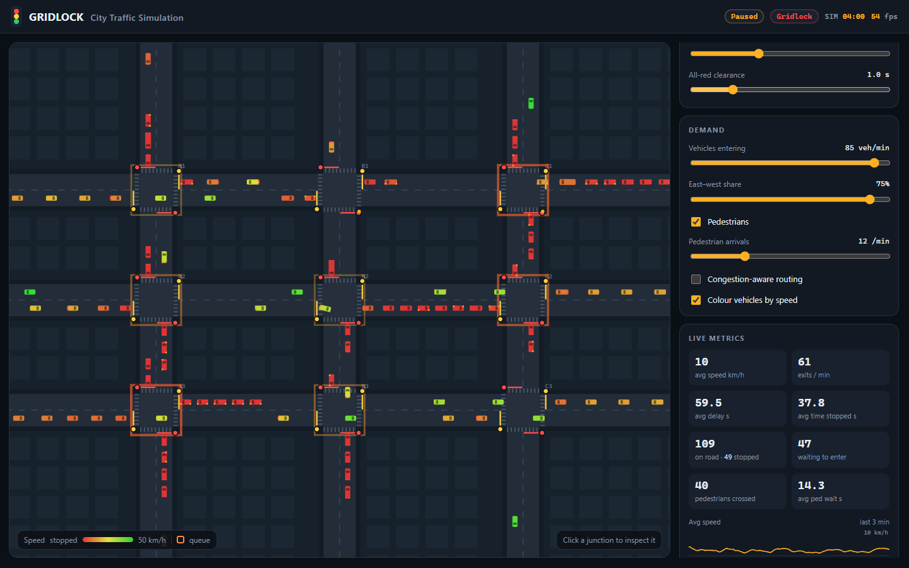
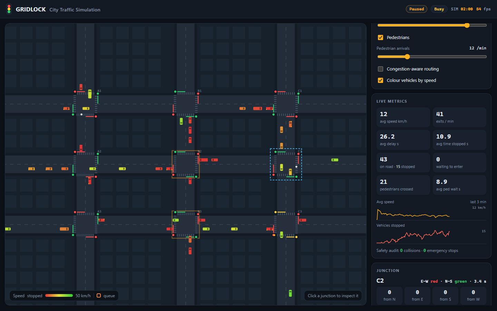
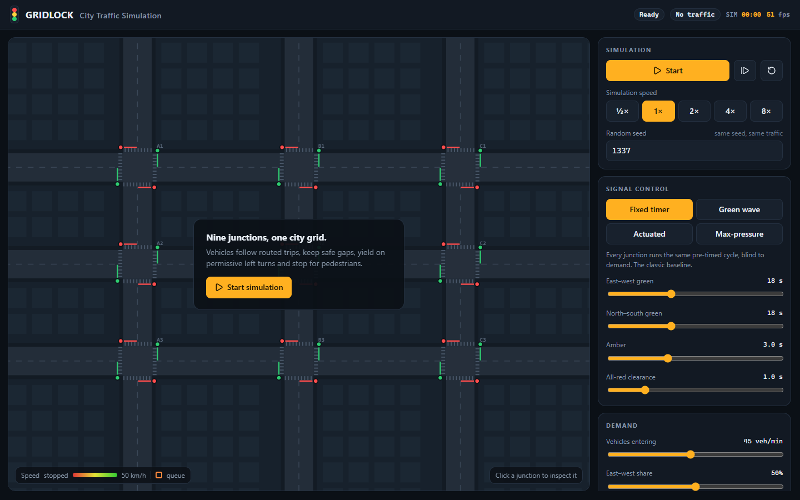
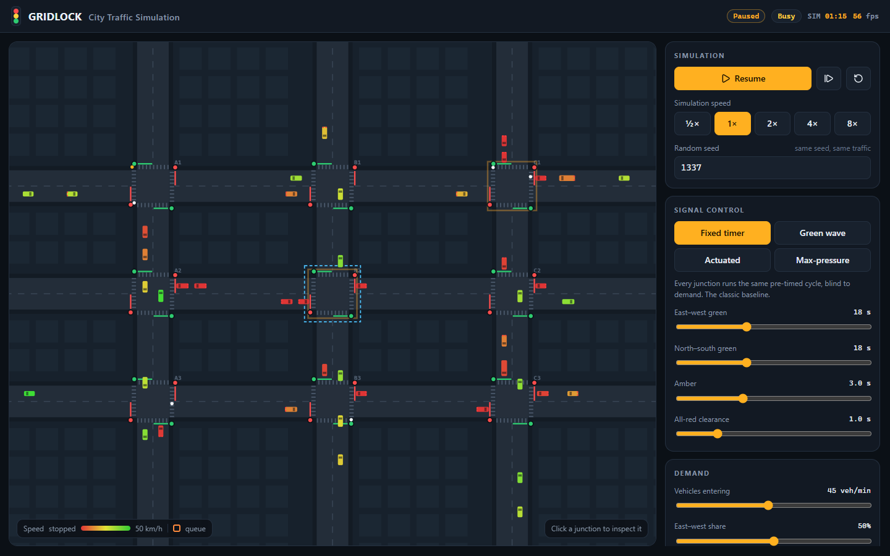
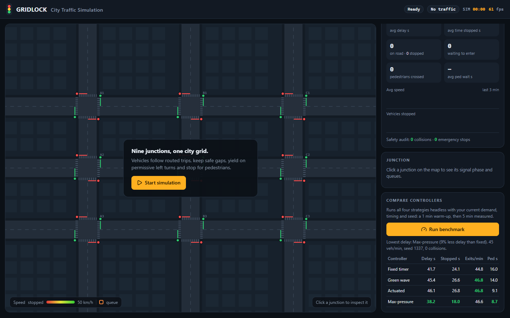
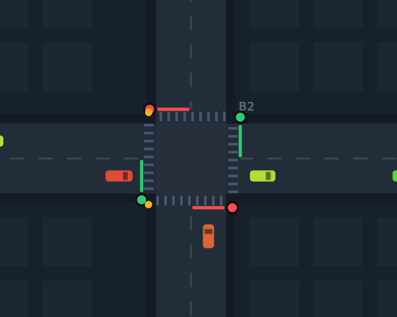
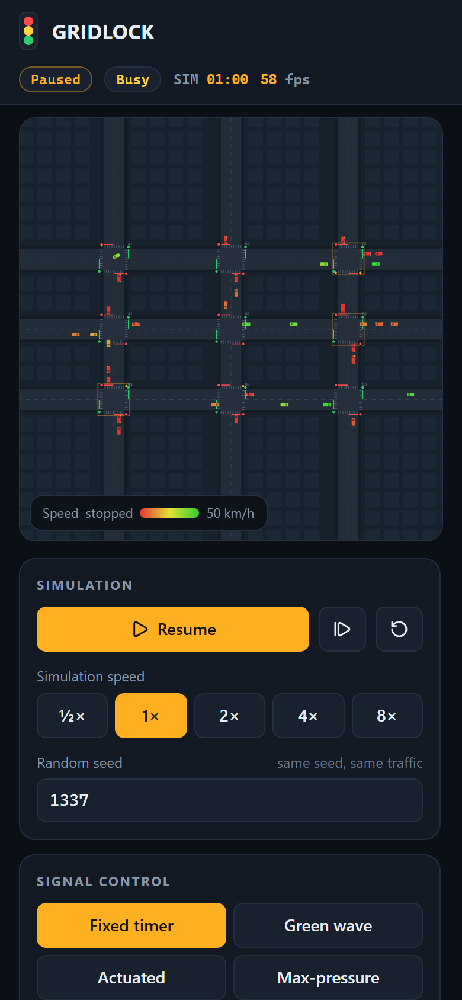

# Gridlock: City Traffic Simulation

An interactive, browser-based traffic simulation of a 3×3 grid of signalised junctions. Vehicles drive routed trips with a car-following model, queue and spill back, yield on permissive left turns and stop for pedestrians. Four traffic-signal strategies, from a fixed timer to a max-pressure controller, can be compared live or in a headless benchmark that runs inside the page.

**Live demo:** https://delilahg.github.io/gridlock-traffic-simulation/



| Rush hour with spillback | Max-pressure control with junction inspector |
| --- | --- |
|  |  |

## Features

- **Road network**: 9 junctions, 48 single-lane links and 108 turning movements. Every movement is a real geometric path: straight lines, plus circular arcs for turns.
- **Vehicle dynamics**: the [Intelligent Driver Model](https://en.wikipedia.org/wiki/Intelligent_driver_model) (IDM) handles acceleration, comfortable braking, speed-dependent following gaps and stopping at lines. Each driver has their own desired speed, and roughly 8% of vehicles are longer vans.
- **Routing**: each vehicle gets an origin–destination trip and follows a Dijkstra shortest path, weighted by free-flow time plus turn penalties. An optional *congestion-aware routing* mode re-plans each departure around current queues.
- **Junction safety logic**:
  - a conflict table built from the movement geometry
  - permissive left turns with gap acceptance (5 s critical gap)
  - "don't block the box" checks on downstream space
  - a dilemma-zone commitment rule for amber
  - turning vehicles yield to pedestrians
- **Pedestrians**: arrive at random crosswalks, wait for a safe crossing window, and hold the green until they have finished crossing.
- **Four signal strategies**: Fixed timer, Green wave (coordinated offsets), Actuated (gap-out detectors), and Max-pressure.
- **Configurable timing**: green times, min/max green, gap-out, amber and all-red. Changes apply to the running simulation.
- **Controls**: start, pause, resume, step one second, reset, five simulation speeds (½× to 8×), and a reproducible random seed. Keyboard shortcuts: <kbd>Space</kbd> start/pause, <kbd>R</kbd> reset, <kbd>→</kbd> step.
- **Demand**: total vehicles per minute, the east–west/north–south split, and pedestrian rate.
- **Live metrics**:
  - average speed, exits per minute, average delay, time stopped
  - vehicles on the road, stopped, and waiting to enter (spillback)
  - pedestrian counts and waits
  - 3-minute sparklines
  - a network state badge (Free flow / Busy / Heavy / Gridlock)
- **Visual feedback**: vehicles coloured by speed, brake lights, turn indicators, a congestion ring around junctions with long queues, and a list of the longest queues.
- **Junction inspector**: click any junction to see its phase, stage time, queue per approach, waiting pedestrians and, for max-pressure, the pressure on each phase.
- **Benchmark**: runs all four controllers headless with your current settings and seed (1 min warm-up, then 5 min measured) and highlights the best result for each metric.
- **Independent safety audit**: a separate collision detector (oriented-box overlap test) counts any vehicle–vehicle or vehicle–pedestrian overlap. The driving logic never reads it, and it reports zero in every tested configuration.

## Technology

- Vanilla JavaScript (ES modules) and Canvas 2D. No UI framework.
- [Vite](https://vite.dev) for the dev server and production build. The build is about 36 KB of JS (14 KB gzipped).
- [Lucide](https://lucide.dev) icons.
- Node's built-in test runner for unit tests and [Playwright](https://playwright.dev) for browser tests.
- ESLint (flat config).

## Getting started

Requires Node.js 20 or newer.

```bash
npm install
npm run dev        # http://localhost:5173
```

Production build and local preview:

```bash
npm run build
npm run preview    # http://localhost:4173
```

No environment variables, API keys or backend services are needed. Everything runs in the browser.

## Testing

```bash
npm run lint       # ESLint
npm test           # 32 unit / simulation tests (Node test runner)
npm run test:e2e   # 10 Playwright browser tests (builds and serves the app)
npm run check      # all of the above plus the production build
```

Browser tests use the preinstalled Microsoft Edge on Windows, so nothing needs to be downloaded. On macOS or Linux, run `npx playwright install chromium` once, or set `PW_CHANNEL=chrome` to use an installed Chrome.

**What the tests cover**

- *Geometry and network*: path arc-length maths, arc radii, oriented-box overlap, topology counts, a symmetric conflict table, and that all 132 origin–destination routes exist and are contiguous.
- *Dynamics*: IDM free acceleration, stopping before an obstacle without overrunning it, and larger following gaps at higher speed.
- *Signals*:
  - exact green → amber → all-red sequencing and durations
  - **no controller ever opens both axes**, checked every step in every mode
  - actuated control rests in green, gaps out, and respects max green
  - max-pressure switches toward the higher-pressure phase
  - green-wave offsets match the travel time between columns
- *Simulation*, checked every step for each controller at 80 veh/min:
  - zero vehicle collisions, zero pedestrian collisions, zero emergency stops
  - no pedestrian ever on a crosswalk whose road has a green
  - no vehicle stuck inside a junction box
  - vehicles only commit on green, or as a left turn clearing on amber
- *Simulation, other*: determinism by seed, vehicle conservation, saturation behaviour without NaNs, live demand, pedestrian and timing changes, and a per-step performance budget.
- *Browser*: ready state, start/pause/resume/reset, single step, keyboard shortcuts, mode switching with matching timing controls, live sliders, seed, junction inspector, the full benchmark, mobile layout without horizontal scroll, and no console errors.

Latest local run: lint clean, **32/32** unit tests and **10/10** browser tests passing.

## Results: does adaptive control help?

Average delay per trip (actual trip time minus free-flow trip time), averaged over 4 seeds, with 1 min warm-up and 5 min measured. Pedestrians are on, at 12/min. Lowest delay is in bold; throughput is in exits per minute.

| Scenario | Fixed | Green wave | Actuated | Max-pressure |
|---|---|---|---|---|
| Light (15 veh/min) | 23.4 s · 17/min | 25.8 s · 17/min | 17.0 s · 17/min | **16.6 s** · 17/min |
| Moderate (30) | 25.2 s · 28/min | 29.2 s · 31/min | 26.0 s · 29/min | **21.8 s** · 30/min |
| Default (45) | 41.3 s · 41/min | 40.5 s · 41/min | 38.5 s · 43/min | **36.5 s** · 44/min |
| Unbalanced (45, 75% E–W) | 42.9 s · 40/min | 44.3 s · 41/min | 41.0 s · 41/min | **40.7 s** · 40/min |
| Near saturation (60) | **53.0 s** · 47/min | 59.6 s · 46/min | 54.2 s · 48/min | 54.5 s · 47/min |

What this shows:

- Demand-responsive control helps most when traffic is light or moderate: max-pressure cuts delay by about 29% at 15 veh/min and 12% at the default load.
- Near saturation, long fixed cycles are as good or better. Every phase change wastes about 4 s of amber and all-red, and capacity is ultimately limited by single-lane approaches where one waiting left-turner blocks everyone behind it.
- The green wave only coordinates eastbound progression. On a grid with two-way traffic and short north–south blocks, it doesn't beat a plain fixed timer.
- Results vary from seed to seed, which is why the table averages four seeds. The in-app benchmark uses a single seed, so expect some variation there.

These numbers come from this model and are useful for comparing strategies. They are not calibrated predictions for any real city.

## Architecture

```
src/
  sim/                 pure simulation (no DOM; runs in Node and the browser)
    constants.js       geometry, units (1 px = 0.25 m), IDM parameters
    geometry.js        Path (arc-length polyline), arcs, oriented-box overlap
    network.js         grid builder, connectors, conflict tables, Dijkstra routing
    signals.js         two-phase controller: fixed, wave, actuated, max-pressure
    simulation.js      vehicles, junction permissions, pedestrians, metrics, audit
    rng.js             seeded PRNG (mulberry32), exponential arrivals
  render.js            Canvas renderer (cached static layer + dynamic layer)
  main.js              UI wiring, main loop, benchmark
tests/unit/            Node test runner
tests/e2e/             Playwright
scripts/screenshots.mjs  regenerates docs/screenshots from the real build
```

### Key engineering decisions

- **Everything is a path.** Lanes and turning movements share a single `Path` abstraction parameterised by arc length, so a vehicle's state is just `(route, index, s, v)`. Car following, look-ahead across junctions and drawing all use the same `pointAt(s)` call, and turns follow real arcs instead of snapping direction.
- **IDM for longitudinal control.** IDM is collision-free in its continuous form and reproduces realistic queue discharge and stop-and-go waves with five interpretable parameters. Red lights and blocked junction entries are modelled as stationary virtual leaders at the stop line.
- **Commit-or-stop junction logic.** The front vehicle of each approach asks for permission. To get it, the signal must be green; no conflicting movement may be occupied or reserved; there must be room downstream; crosswalks on its path must be clear; and a left turn needs a 5 s gap in opposing traffic. Once stopping would need more than 3.5 m/s², the vehicle *commits*, reserving the movement until it has crossed. This handles amber dilemma zones, prevents box blocking, and makes simultaneous conflicting entries impossible by construction. An independent overlap detector checks that this holds.
- **Fixed timestep (50 ms) and a seeded RNG.** Simulation results don't depend on frame rate, a run can be replayed exactly from its seed, and the in-page benchmark runs identical demand through each controller. Arrivals form a Poisson process, drawn as exponential inter-arrival times.
- **Max-pressure variant.** For each phase, the controller sums the vehicles waiting on its approaches, weighting each by how much space is left on the link it wants to enter: (1 − occupancy). After the minimum green it switches when the other phase's pressure clearly exceeds the current one, or serves a waiting cross street immediately if the current approaches are empty. This is a practical variant of Varaiya's max-pressure policy, adapted to a two-phase signal with amber and all-red.
- **Actuated control uses advance detection.** North–south blocks are only 24 m long, so a detector at the stop line alone would make arriving cars stop every time. Demand is detected anywhere on the approach link and on vehicles already turning into it upstream. Green is extended while vehicles occupy a 35 m zone, ends after a gap or at max green, and stays green when nobody is waiting on the cross street.
- **Pedestrians hold the green they started in.** A pedestrian only starts if the crossing can finish before the green ends (for fixed timing) or within max green (for adaptive control). The controller can't end that green until the crosswalk is clear, and the all-red stage waits for crosswalks on the road about to turn green.
- **Performance.** The static city is drawn once to an off-screen canvas. Each frame only draws signals, vehicles and pedestrians. One simulation step with about 100 vehicles takes roughly 0.07 ms, so 8× speed and the 4 × 6-minute benchmark (28,800 steps) stay responsive. The benchmark yields to the browser every 12 ms.

## Limitations and known issues

- Every road is single-lane in each direction. There are no turn bays, lane changes or overtaking, so a waiting left-turner blocks the lane behind it. That's realistic for narrow streets but caps capacity.
- Junctions run two phases with permissive lefts. There are no protected left-turn arrows and no right turn on red.
- Pedestrians cross only at junction crosswalks and don't have their own walk signals or push buttons. A pedestrian who has waited more than 10 s counts as demand for adaptive controllers.
- The green-wave plan is computed when the simulation is built. Changing green times afterwards keeps the cycles aligned but doesn't recompute the optimal offsets.
- `npm audit` reports a moderate advisory in `minimatch`, pulled in by ESLint. It only affects the local lint tooling, not the shipped app.
- The model is uncalibrated. Use it to compare strategies, not to predict a real city.

## Possible improvements

- Multi-lane links with lane changing (MOBIL), turn bays and protected left phases.
- Configurable network sizes and an editor for closing roads or adding junctions.
- Confidence intervals in the benchmark, using multiple seeds in a Web Worker.
- Time-varying demand profiles, such as morning and evening peaks.

## Screenshots

| | |
| --- | --- |
|  |  |
|  |  |



All screenshots and the GIF are captured from the real production build by `npm run screenshots`.

## License

[MIT](LICENSE)
